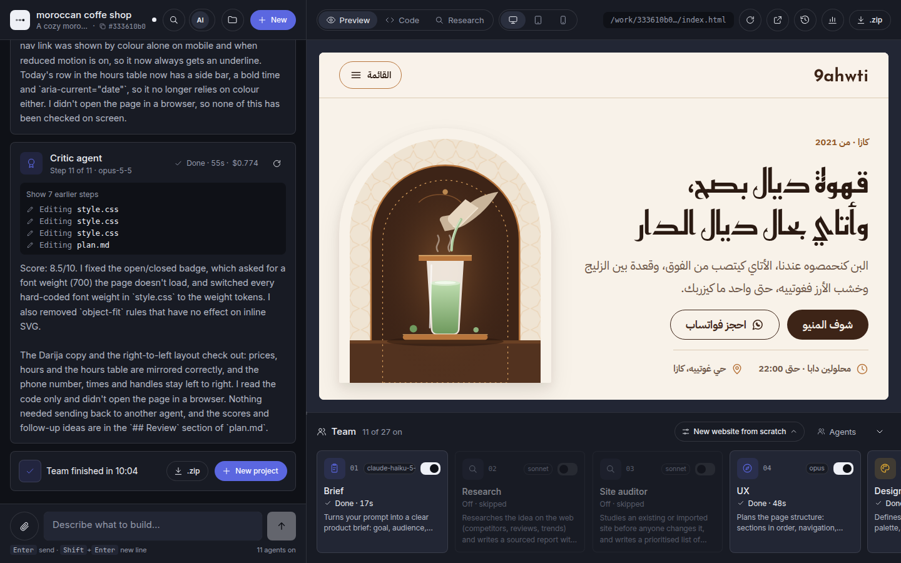

# Agents Atelier

**Hire AI agents, not freelancers. Describe the website you need, and a team of specialist AI agents builds it in
front of you, step by step, with independent specialists working side by side.**

Agents Atelier works like a freelance platform where every specialist is an AI agent. Instead of writing a job post,
comparing offers and waiting days for a delivery, you describe the job and hire a team that starts at once: a UX agent
plans the page, a Design System agent picks the colours and fonts, a Copywriter writes the text, then HTML, CSS,
Responsive, JS and Animation agents build it. An Accessibility agent audits it, and a Critic reviews and scores the
result in a real browser, sending bigger problems back to the agent that owns them.

| On a freelance platform                 | On Agents Atelier                                                       |
|-----------------------------------------|-------------------------------------------------------------------------|
| Browse profiles and hire people         | Browse **35 specialist agents** with profiles, ratings and portfolios  |
| Hire an agency for a whole job          | Hire one of **23 ready teams** (restaurant site, portfolio, 3D site, contact options…), each with a starting prompt |
| Offers, then days of waiting             | **Start a job**: pick one of your projects and the team starts at once  |
| Each round of changes means new messages | Ask for a change anytime: **only the agents it needs** work on it      |
| You trust a profile                     | Every agent's **results, ratings, time and cost** are shown, and on Pro its **instructions** too |
| Build your own agency                   | **Duplicate any agent**, change its instructions, save **your own teams** |

The work itself is **front end only**: the team builds a finished static website (one page or several) in plain HTML,
CSS and JavaScript that you download and host anywhere.

### The whole idea in one paragraph

Agents Atelier is a web platform that works like a freelance marketplace, except that every specialist you hire is an
AI agent: rather than posting a job, comparing offers and waiting days for a delivery, you describe the website you
need and hire a team of agents that starts working the moment you press Enter. Each project begins with a name, a short
description and optional answers about your audience, goal, tone, colours, languages and must-have content; you can
give it its own brand kit (logo, colours, fonts), or import an existing site to improve. You then pick one of 23
ready use-case teams (a restaurant site, a portfolio, a landing page, a redesign, a multilingual version, legal
pages, a 3D site, contact options…), each with a starting prompt to fill in, or choose agents yourself from 35 specialists: a Brief agent turns your
request into a clear brief, UX plans the structure, Design System sets the colours and fonts, the Copywriter writes
every word, HTML, CSS, JS, Responsive and Animation agents build the pages, Accessibility audits them, and QA and the
Critic check the result in a real browser at desktop and phone width, fix small problems and send bigger ones back to
the agent responsible. You watch all of it live in the studio, with each agent's steps, time and cost, a preview that
reloads after every edit, a code editor and a version saved after every agent, and after the first build an
Orchestrator runs only the agents each follow-up needs. You can stop, continue, retry a single agent, or duplicate any
agent and edit its Markdown instructions to build your own teams. The result is plain HTML, CSS and JavaScript you
download as a .zip and host anywhere, inside a platform with real accounts, plans, revenue and monitoring analytics
for admins, privacy tools and an interface in English, French or Moroccan Darija. The agents run on each member's own
Claude API key, so members pay Anthropic directly for the AI and the plans only unlock features.

You watch every step live. You can stop, steer, retry or roll back any of them, and at the end you download plain
HTML, CSS and JavaScript files that are yours.

> **Front end only.** The agents write the part of a site that runs in the browser: layout, styles, copy, images
> (SVG), interactions and animations. They don't build a back end: no server code, database, user accounts,
> payments or APIs. Forms, logins and data in the result are front-end mock-ups; connect them to a real back end
> yourself if you need one.

Every agent is **Claude Code** running with a different role. On a public install each member adds **their own Claude
API key** in their profile and the agents run on it (`CLAUDE_KEYS=user`, the default); on a private install everyone can
use the server's own Claude Code login (`CLAUDE_KEYS=server`). People sign up with an email and a password; accounts,
agents and teams live in Postgres. The app speaks **English, French and Moroccan Darija** (right to left), in light or
dark.



*The studio: talk to the team on the left, watch the page being built on the right, and see each agent's step in the
team strip below. (Light theme: [docs/screenshots/studio-light.png](docs/screenshots/studio-light.png).)*

> Technical documentation (architecture, API, data formats, internals) is in **[doc.md](doc.md)**.

## Contents

- [Why Agents Atelier](#why-agents-atelier)
- [How it works](#how-it-works)
- [Getting started](#getting-started)
- [Using it](#using-it)
- [The agent team](#the-agent-team)
- [The marketplace](#the-marketplace)
- [Plans and your Claude key](#plans-and-your-claude-key)
- [Customising the agents](#customising-the-agents)
- [Sharing agents and teams](#sharing-agents-and-teams)
- [Share links, comments and teamwork](#share-links-comments-and-teamwork)
- [Languages, theme and colours](#languages-theme-and-colours)
- [Accounts, privacy and protection](#accounts-privacy-and-protection)
- [Analytics for admins](#analytics-for-admins)
- [Where things are kept](#where-things-are-kept)
- [Good to know](#good-to-know)
- [FAQ](#faq)
- [Tests](#tests)
- [Troubleshooting](#troubleshooting)
- [Project layout](#project-layout)

---

## Why Agents Atelier

Most AI website builders are a single assistant behind a chat box. You ask, wait, and get a result you can only
accept or re-roll. Agents Atelier works more like a small design studio:

| A single AI builder                         | Agents Atelier                                                                 |
|---------------------------------------------|--------------------------------------------------------------------------------|
| One generalist does everything at once      | **35 specialists**, each with one job and its own instructions                 |
| A blank chat box                            | **23 use-case teams**, each with the right agents and a prompt to fill in      |
| You see the result, not the process         | You see **every agent, every file it touches, how long it took and its cost**  |
| Unhappy? Regenerate everything              | **Retry just one agent** ("CSS: warmer palette") or **roll back** to any step |
| Stopping loses the work                     | **Stop, then Continue** from where it stopped, even after a crash              |
| Nobody looks at the page                    | **Real browser checks** at desktop and phone width: layout, accessibility, errors |
| Fixed behaviour                             | Every agent is a **Markdown file you can edit**, with its own model            |
| Hosted, often framework code                | Outputs plain HTML/CSS/JS with **no build step**, hosted anywhere              |

It's a good fit for landing pages, portfolios, restaurant and local business sites, product and event pages, small
brochure sites, UI prototypes and mock-ups to hand to a back-end developer. It's not meant for web apps that need a
server, a database or logins.

## How it works

```text
            you: "A one-page site for Lumen, a bike repair shop in Lyon…"
                                        │
   ┌──────────────┐   ┌──────────────┐  │  ┌──────────────┐        ┌──────────────┐
   │  UX          │ → │ Design System│ →│→ │  Copywriter  │ → … →  │  Critic      │
   │ plan.md      │   │ :root tokens │     │ all the text │        │ fixes + score│
   └──────────────┘   └──────────────┘     └──────────────┘        └──────────────┘
          │                  │                    │                        │
          └──────────────────┴──── one shared project folder ──────────────┘
                     index.html · style.css · script.js · plan.md
                                        │
                     live preview reloads after every file written
```

1. **One project, one folder.** Each project has its own folder of files: `index.html`, `style.css`, `script.js`
   and `plan.md`. The agents work on these files directly.
2. **Agents run in order.** Each agent is a separate Claude Code session with a role prompt. It reads the current
   files, does only its own job, and hands over a one-line note to the agents after it.
3. **`plan.md` is the shared memory.** The UX agent writes the structure, Design System the tokens, the Copywriter
   the text, and so on. Each agent owns one section, so later agents build on earlier decisions instead of guessing.
4. **Small edits, never overwrite.** The shared rules tell agents to change only what their job needs, so the CSS
   agent doesn't undo the HTML agent's work.
5. **You see it live.** Every file read or written appears on the agent's card. The preview reloads after each
   change, and a version of the code is saved after each agent.

### What happens when you press Enter

**Who works is decided first:**

- **First prompt on a new project:** every agent in the project's team builds the site. If an agent in the team needs a
  contact detail you haven't given (a WhatsApp number, an email…), a short form asks for it first.
- **Any later prompt:** the **Orchestrator** reads your request and the project (files, `plan.md`, earlier requests, the
  last run) and picks only the agents the request needs. "Make the buttons rounder" runs CSS, not the whole team. Its
  choice and reason appear in the chat, and the run starts right away (press Stop if it picked wrong). It may also pick
  a helper that isn't in the team when the request clearly needs it ("translate the site into Arabic" brings in the
  Translator).
- **The Brief agent always runs** whenever any agent runs, so it's always in the team (with a lock instead of ×). On follow-ups it restates your
  request as a precise change instead of rewriting the brief.
- The server adds what the Orchestrator might forget: agents that must adapt (HTML changes → CSS) and **QA + Critic
  after any code change**.
- **Unclear, off-topic or a question** ("fix it", "write me a poem", "which fonts did you use?"): no agent runs. The
  Orchestrator answers, or asks what it needs as a short **form** in the chat (choices, checkboxes or a text field);
  answer it and the right agents start.
- **Big changes wait for your yes.** For a request that would rework most of the site, the Orchestrator shows its plan
  with **Yes, start** and **Cancel** instead of starting at once.
- **Template blanks.** A use-case prompt still containing `[blanks]` is turned into a form before anyone works.
- If the Orchestrator fails or gives an unusable answer, the whole team runs, so a prompt is never blocked.

The Orchestrator's instructions are in `agents/_orchestrator.md`.

A typical first build with the default team (times vary):

| Time   | Agent          | What it does                                                                 |
|--------|----------------|------------------------------------------------------------------------------|
| 0:00   | (server)       | A version "Before: …" is saved                                               |
| 0:00   | Brief          | Turns your prompt into a brief: goal, audience, tone, success criteria       |
| 0:20   | UX             | Writes `## Structure` in `plan.md`: sections, navigation, calls to action    |
| 0:50   | Design System  | Puts colours, fonts, type scale and spacing as CSS variables in `style.css`  |
| 1:20   | Copywriter     | Writes every headline, button label and form message                         |
| 2:00   | HTML           | Builds `index.html` from the plan and the copy (the preview appears)         |
| 2:30   | CSS            | Styles everything with the tokens                                            |
| 3:10   | JS             | Adds the menu, forms and smooth scrolling                                    |
| 3:40   | Responsive     | Makes it work from 320px phones to wide screens                              |
| 4:10   | Animation      | Adds scroll reveals and micro-interactions                                   |
| 4:40   | Accessibility  | Fixes contrast, focus, labels and headings (WCAG 2.2 AA)                     |
| 5:20   | Critic         | Gets a browser check, fixes small issues, sends big ones back (up to 2 rounds), scores out of 10 |

### What every agent knows

Each agent receives:
- the **project's name and description**, and the answers to the optional project questions (audience, goal, tone,
  colours, languages, must-have content)
- the project's **brand kit** (logo, colours, heading and body fonts) in a `<brand_kit>` block
- the **current request**, plus the last few requests in the project
- the **notes from the agents before it**, for example "CSS agent: styled the hero; the menu button uses `data-menu-toggle`"
- any **reference images** you attached
- the project's **contact details** (WhatsApp, phone, email, Telegram) for the contact agents, and the **smaller WebP
  copies** of your photos to use in `srcset`
- for Responsive, Accessibility, QA and the Critic: a **browser check** (see below)
- the **shared rules** (`agents/_common.md`) followed by **its own role**, then security rules the server adds last
- an instruction to write its chat messages in **your interface language** (French or Darija); the site itself keeps
  following the brief

Agents can only use file tools (read, write, edit, search) inside the project folder. They can't run commands or start
other agents. Only agents marked for web research (Research) can search the web.

### Real browser checks

Agents have no browser of their own, so before **Responsive**, **Accessibility**, **QA** and the **Critic** work
(only before the Critic on the Starter plan), the server opens every page in headless Chrome at desktop (1280px) and
phone (390px) width and hands over what it measured:
- **Errors:** console errors, files that failed to load, broken images, links to missing pages or anchors.
- **Layout:** sideways scrolling and the element that's too wide, overlapping elements, a header wrapping onto two rows,
  large blank bands, sections that are too narrow, a lonely card on the last row.
- **Accessibility:** an axe-core (WCAG 2.2 AA) audit: contrast, labels, alt text, heading order and more.

Each of those agents is told to fix what's in its area first, and the Critic may not leave a reported problem behind: it
fixes small ones and sends the rest back to the agent responsible. Screenshots go to the project's `checks/` folder
(left out of downloads and versions), and a summary card with thumbnails appears in the chat. Turn it off with
`BROWSER_CHECKS=false`; set `CHROME_BIN` if Chrome isn't found.

## Getting started

### Requirements

- **Python 3.10+**
- **Docker** (for Postgres), or any Postgres 14+ you point `DATABASE_URL` at
- **[Claude Code](https://claude.com/claude-code)** installed (`claude` on the PATH, or `CLAUDE_BIN`). With the default
  `CLAUDE_KEYS=user`, each member adds their own **Claude API key** (from console.anthropic.com) in their profile; with
  `CLAUDE_KEYS=server`, Claude Code must be logged in on the server.
- **Google Chrome or Chromium** (optional) for the real browser checks
- A modern browser (Chrome, Firefox, Safari, Edge).

### Run it

```bash
cp .env.example .env      # then set ADMIN_EMAIL (and SMTP_* to send real email)
./run.sh
```

Then open **<http://localhost:8001>**.

The first start creates a Python virtual environment in `.venv/`, installs the packages in `requirements.txt`, starts
Postgres with Docker (`database/docker-compose.yaml`) and applies the database migrations. After that it starts in a
second. Stop the server with `Ctrl+C`; Postgres keeps running until you run
`docker compose -f database/docker-compose.yaml down`.

### Run it with Docker

Docker runs everything: the app, Postgres, Claude Code (which every agent runs on) and Chromium (for the browser
checks). Only Docker is needed on the machine.

```bash
cp .env.example .env                 # then set ADMIN_EMAIL (and SMTP_* to send real email)
docker compose up -d --build         # http://localhost:8001
```

**Who pays for the agents** is set by `CLAUDE_KEYS` in `.env`:
- `user` (the default): every member, admins included, adds their own Claude API key on **/profile → Claude and
  spending**. Nothing runs without one, and the server's own login is never used.
- `server` (a private install): everyone runs on the server's Claude Code login. Log it in once, with one of these (the
  login is kept in the `claude` volume):

| How | Do this |
|---|---|
| Your Claude subscription, interactively | `docker compose exec app claude`, type `/login`, open the link and paste the code back |
| Your Claude subscription, with a token | run `claude setup-token` on any machine, put `CLAUDE_CODE_OAUTH_TOKEN=…` in `.env`, then `docker compose up -d` |
| An Anthropic API key (billed per use) | put `ANTHROPIC_API_KEY=…` in `.env`, then `docker compose up -d` |

| Command | What it does |
|---|---|
| `docker compose logs -f app` | Follow the server log (without SMTP, sign-up codes are printed here) |
| `docker compose exec app python manage.py make-admin you@example.com` | Make an account admin |
| `docker compose exec app python manage.py migrations` | List the database migrations |
| `docker compose down` | Stop (data stays in the `pgdata` and `claude` volumes and the `storage/` folder; `-v` deletes the volumes) |
| `docker compose up -d --build` | Update after pulling new code (migrations run on start) |

- The app is published on `127.0.0.1:8001` only (`APP_PORT` in `.env` changes the port). To go public, put a reverse
  proxy with HTTPS in front, set `TRUST_PROXY=true`, `COOKIE_SECURE=true` and `ATELIER_HOSTS=your.domain`.
- The container settings (database address, storage folder, Chromium) are set in `docker-compose.yml` and win over
  `.env`, so the same `.env` works with `./run.sh` and with Docker.
- **Coming from an earlier version** with a `work/` folder: uncomment the `./work:/data/work:ro` line in
  `docker-compose.yml` before the first start; its projects are imported into the `storage` volume once.
- **Your data is shared with `./run.sh`:** the database is the same `pgdata` volume as `database/docker-compose.yaml`,
  and files are the project's `storage/` folder, so you can switch between Docker and `./run.sh` (one at a time).
  The container runs as user id 1000; if your user id differs, `sudo chown -R 1000 storage`.
- **Backups:** `docker compose exec db pg_dump -U atelier atelier > backup.sql`, and the `storage/` folder.
- Run one app container only: it keeps each project's live state (running agents, the write queue) in memory.

### Your admin account

1. In `.env`, set `ADMIN_EMAIL` to your email, then start the server.
2. Open **/register** and create your account with that email, accepting the terms.
3. Enter the 6-digit code from the email. **Without `SMTP_HOST` no email is sent: the code is in the server log.**
4. You're the admin. `server/manage.py make-admin <email>` promotes another account later.

| Role          | Can do                                                                                                   |
|---------------|----------------------------------------------------------------------------------------------------------|
| Not confirmed | Only enter the code from the email (or ask for a new one) and log out                                    |
| User          | Their own projects; uses the shared agents and teams; what else depends on their **plan** (see [Plans](#plans-and-your-claude-key)) |
| Admin         | Every feature, no plan limits, plus: changes the shared agents, teams and rules, opens every project, manages users, roles and plans on **/users**, sees revenue and monitoring on **/analytics** |

A user's agents and teams are private to them. Visitors who aren't logged in only see the landing page, the login and
sign-up pages and the legal pages.

### Settings

Settings live in a **`.env`** file at the project root; `.env.example` documents every one. A variable set on the
command line wins over the file: `AGENT_MODEL=sonnet PORT=9000 ./run.sh`. Restart the server after changing `.env`.

| Variable | Default | What it does |
|---|---|---|
| **Server** | | |
| `HOST` / `PORT` | `127.0.0.1` / `8001` | Address and port the server listens on |
| `ATELIER_HOSTS` | *(empty)* | Extra host names allowed to reach the server, comma-separated |
| `LOG_LEVEL` | `INFO` | `DEBUG`, `INFO`, `WARNING` or `ERROR` |
| `STORAGE_DIR` | `storage` | Where every file is kept (see [Where things are kept](#where-things-are-kept)) |
| `ATELIER_WORK` / `ATELIER_AGENTS` | `work` / `agents` | The old projects folder (imported once) and the source of the shared agents |
| **Claude Code** | | |
| `CLAUDE_BIN` | `claude` | Path to the Claude Code executable |
| `AGENT_MODEL` | your Claude Code model | Model for agents that don't set their own (e.g. `sonnet`) |
| `AGENT_TIMEOUT` | `900` | Seconds before a stuck agent is stopped (you can then press **Continue**) |
| `PARALLEL_AGENTS` | `3` | Most agents the Orchestrator may let work at the same time; `1` runs them one after another |
| `PAYPAL_CLIENT_ID` / `PAYPAL_CLIENT_SECRET` | *(empty)* | Turn on online payment with PayPal subscriptions; empty keeps upgrades as requests an admin approves |
| `PAYPAL_MODE` | `sandbox` | `sandbox` (test money) or `live` |
| `PAYPAL_PLAN_PRO` / `PAYPAL_PLAN_AGENCY` | *(empty)* | PayPal plan ids, printed by `manage.py paypal-setup` |
| `PAYPAL_WEBHOOK_ID` | *(empty)* | The id of your PayPal webhook, used to check that webhooks really come from PayPal |
| `PUBLIC_URL` | *(empty)* | The app's public address (e.g. `https://atelier.example.com`), where PayPal and Google/GitHub send people back |
| `GOOGLE_CLIENT_ID` / `GOOGLE_CLIENT_SECRET` | *(empty)* | Show **Continue with Google** on the login and sign-up pages. Callback: `<PUBLIC_URL>/api/auth/oauth/google/callback` |
| `GITHUB_CLIENT_ID` / `GITHUB_CLIENT_SECRET` | *(empty)* | Show **Continue with GitHub**. Callback: `<PUBLIC_URL>/api/auth/oauth/github/callback` |
| `API_REQUESTS_PER_MINUTE` | `600` | API calls per member (or per address when logged out) per minute; `0` = no limit |
| `RUNS_PER_HOUR` | `60` | Runs that start agents (prompt, Continue, Start again, retry) per member per hour |
| `INVITES_PER_HOUR` / `SHARE_LINKS_PER_HOUR` / `CHECKOUTS_PER_HOUR` | `30` / `30` / `10` | Per member per hour |
| `COMMENTS_PER_HOUR` | `30` | Comments through share links, per visitor address per hour |
| `CLAUDE_KEYS` | `user` | `user`: each member runs on their own Claude API key · `server`: everyone uses the server's Claude Code login |
| `KEY_SECRET` | *(generated)* | Fernet key that encrypts members' API keys; empty = one is made and kept in `storage/.secrets/` |
| `REVIEW_ROUNDS` | `2` | Times the Critic may send work back in one run |
| `ATELIER_PLAN` | `pro` | `free`: the Critic reviews once and never sends work back |
| **Limits** | | |
| `MAX_BODY_MB` / `MAX_IMAGE_MB` | `8` / `5` | Largest request / reference image |
| `MAX_SITE_IMPORT_MB` | `40` | Largest existing site a project can start from |
| `MAX_EDIT_KB` | `500` | Largest file the Code tab opens or saves |
| `MAX_VERSIONS` | `150` | Versions kept per project (the oldest go first) |
| `MAX_ASSETS` | `12` | Logo and photos a new project can be given |
| **Database and accounts** | | |
| `DATABASE_URL` | local Docker Postgres | Where accounts, agents and teams live |
| `ADMIN_EMAIL` | *(empty)* | This account becomes admin once confirmed |
| `SESSION_DAYS` | `30` | Days a login stays valid |
| `COOKIE_SECURE` | `false` | Set `true` when served over HTTPS |
| `CODE_MINUTES` | `15` | Minutes an email code stays valid |
| `ACCOUNT_DELETE_DAYS` | `30` | "Delete my account" deactivates it; it's deleted for good this many days later unless its owner logs in |
| `ACCOUNT_PURGE_SECONDS` | `3600` | How often the server deletes the accounts whose time is up |
| **Sign-up protection** | | |
| `TRUST_PROXY` | `false` | Behind nginx/Caddy, use the visitor's address from `X-Forwarded-For` |
| `SIGNUPS_PER_HOUR` / `LOGINS_PER_15_MIN` / `RESETS_PER_HOUR` | `5` / `30` / `10` | Limits per IP address (`0` = none) |
| `BLOCK_DISPOSABLE_EMAILS` / `DISPOSABLE_DOMAINS_FILE` | `true` / *(empty)* | Refuse throwaway inboxes; add your own domain list |
| **Browser checks** | | |
| `BROWSER_CHECKS` / `CHROME_BIN` | `true` / *(found automatically)* | Real browser checks before Responsive, Accessibility, QA and the Critic |
| **Legal pages** | | |
| `LEGAL_NAME` / `LEGAL_EMAIL` / `LEGAL_ADDRESS` | `Agents Atelier` / *(admin email)* / *(empty)* | Who runs the service, shown on /terms and /privacy. Put the registered company name and address before going public |
| **Email** | | |
| `SMTP_HOST`, `SMTP_PORT`, `SMTP_USER`, `SMTP_PASSWORD`, `SMTP_FROM`, `SMTP_SECURITY` | no email sent | Without `SMTP_HOST`, codes are printed in the server log |
| `EMAIL_OUTBOX` | *(empty)* | Also write every email to this file, one JSON object per line |

## Using it

### Your first job in five steps

0. **Add your Claude API key** once, on **/profile → Claude and spending** (with `CLAUDE_KEYS=user`). The studio shows a
   card with a link if it's missing.
1. **Describe the job.** Click **New project** (the page `/projects/new`). Give it a name and a short description,
   like a job post; the agents read both with every prompt. The optional questions (kind of site, audience, goal, tone,
   languages, must-have content, sites you like, things to avoid) help the first build land closer. Add your logo and
   photos, fill in the project's **brand kit** (logo, up to six colours, heading and body fonts, or copy another
   project's kit), or start from an **existing site** (a folder or a .zip with an `index.html`).
2. **Hire a team.** The studio offers the 23 ready teams: pick one and it becomes the project's team, with its starting
   prompt filled in; replace the parts in [brackets] (or send it as is and answer the form). To change the team later,
   use **Add agents** or **Choose a team** in the studio's team strip: the marketplace opens for this project. Or write your own: *"A one-page site with
   a hero and a booking button, services with prices, opening hours and a map link. Calm, trustworthy."* Attach a
   sketch or screenshot with the paperclip, or paste or drop it. Press **Enter**.
3. **Watch the team work.** Agent cards appear in the chat. The team strip at the bottom shows who's working, who's done
   and who's next, and the preview fills in as files are written.
4. **Ask for changes.** One change at a time: *"make the hero image larger"*, *"add a FAQ section"*. The Orchestrator
   runs only the agents that change needs, on the existing files.
5. **Take the work:** download the result with the **.zip** button. It's plain HTML, CSS and JS, so put it on any host.

The **Guide** (`/guide`, in the account menu) has a full tour, a prompt recipe (what, who, goal, content, style) and
tips for good results.

### The pages

| Page       | Address          | What it's for                                                                 |
|------------|------------------|-------------------------------------------------------------------------------|
| Landing    | `/`              | For visitors: hire AI agents, not freelancers; examples, use cases, features, FAQ |
| Dashboard  | `/`              | Once logged in: your numbers, runs over 14 days, time per agent, recent work  |
| Hire       | `/hire`          | The marketplace: agents and teams by category, search, sort, Start a job       |
| Profiles   | `/hire/agents/<n>`, `/hire/teams/<n>` | Jobs, time, cost, Critic score, ratings, portfolio, instructions (Pro and Agency) |
| Projects   | `/projects`      | Your projects: stats, search, filters, sort, grid or list view, pagination    |
| New project| `/projects/new`  | Every project field on one screen                                             |
| Studio     | `/p/<id>`        | One project: chat, live preview, code, project details, research, versions, stats, team, ratings |
| My agents  | `/agents`        | Mine or shared, on or optional; view, create, edit, reorder, publish, export  |
| My teams   | `/teams`         | Mine or shared use-case teams with their starting prompts; publish           |
| Guide      | `/guide`         | Tour, prompt recipe, tips, shortcuts and FAQ (logged in)                      |
| Profile    | `/profile`       | Five pages: Account, Plan, Claude and spending, Security, Data and deletion   |
| Users      | `/users`         | Admins: every account, Claude key status, plan and role; approve or decline plan requests |
| Analytics  | `/analytics`     | Admins: **Revenue** (monthly revenue, plans, upgrades) and **Monitoring** (health, failures, errors, usage) |
| Legal      | `/terms`, `/privacy` | Terms of use and privacy policy                                           |
| Account    | `/login`, `/register`, `/forgot` | Log in, sign up (with terms), reset a password by 6-digit code |

### Inside the studio

The studio shows only the project you're in. Its address keeps what you're looking at (the tab, the previewed page,
the device width and the open file: `/p/<id>?tab=code&file=style.css`), so a reload or a shared link opens the same view.

| Where                      | What you can do                                                                          |
|----------------------------|------------------------------------------------------------------------------------------|
| Chat                       | Prompt the team, start from a use case, attach reference images, stop a run              |
| Question cards             | Answer the Orchestrator's form, or confirm a big change with **Yes, start**              |
| Agent cards                | See each agent's steps, time and cost; **retry** that agent with an extra instruction   |
| Browser check cards        | What the real browser saw, with desktop and phone thumbnails                             |
| After a stop or an error   | **Continue** from the stopped agent (finished ones are skipped) or **Start again**       |
| **Preview** tab            | The live page at desktop, tablet or phone width, a page switcher for multi-page sites, or open it in a new tab |
| **Code** tab               | Edit any file, with **Auto-save** on or off (Save button or Ctrl/Cmd+S)                  |
| **Project** tab            | Contact details, your images and their WebP copies, QR codes, brand kit and brief       |
| **Research** tab           | The Research agent's sourced report, when it ran                                         |
| **Versions** tab           | A version after every agent: open, compare line by line, download or restore            |
| **Stats** tab              | Cost, time and tokens per agent, and the recent runs of this project                     |
| Team strip                 | The project's agents only; × removes one; **Add agents** / **Choose a team** open the marketplace for this project |

### Multi-page sites

Give a project several pages (Home, About, Contact…) when you create it, or later under **Edit name, description
and pages**. The first page is always `index.html`; the others get file names from their titles (`about.html`,
`contact.html`). Every agent receives the page list, and the HTML agent builds every page with the same header,
navigation and footer and a shared `style.css` / `script.js`. The page switcher above the preview shows any page.

### Command palette and keyboard shortcuts

Press **Ctrl+K** (⌘K on a Mac), or the search button in the header, on any page: jump to any project, agent, team or
page, or run an action (new project, import or export, theme, and in the studio: versions, cost & time, download, stop,
continue, switch view, device or page).

| Keys                    | Action                                         |
|-------------------------|------------------------------------------------|
| `Ctrl+K` / `⌘K`         | Command palette (any page)                     |
| `Enter` / `Shift+Enter` | Send the prompt / new line                     |
| `Ctrl+S`                | Save the open file in the Code tab             |
| `Esc`                   | Close a menu or dialog                         |
| `/` and `N`             | Search projects / new project (Projects page)  |
| `Alt+↑` / `Alt+↓`       | Move an agent up or down (Agents page)         |

## The agent team

The 35 shared agents, in run order. "On" agents are in a new project's team by default; the others are helpers you add
from the marketplace, get with a use-case team, or the Orchestrator brings in when a request needs them.

| Agent          | Default  | Model    | What it does |
|----------------|----------|----------|--------------|
| Brief          | required | haiku    | Turns your prompt into a brief: goal, audience, tone, success criteria |
| Research       | off      | sonnet   | Researches the idea on the web (competitors, reviews, trends) and writes a sourced report |
| Site auditor   | off      | sonnet   | Studies an existing or imported site and writes a prioritised list of what to fix |
| UX             | on       | opus     | Plans the structure: sections, navigation, user flow, calls to action |
| Design System  | on       | opus     | Palette, fonts, type scale, spacing and radii as CSS variables |
| 3D designer    | off      | opus     | Plans the site's 3D: which elements get depth, the object, interaction and fallbacks |
| Copywriter     | on       | sonnet   | Writes every word: headlines, body text, buttons, form labels and errors |
| Content writer | off      | sonnet   | Longer content: about and service pages, articles, FAQs and guides |
| HTML           | on       | sonnet   | Semantic, accessible markup from the plan and the copy |
| Translator     | off      | sonnet   | One copy of every page per language, a language switcher, right-to-left layouts |
| Legal pages    | off      | sonnet   | Privacy policy, legal notice and cookie information, linked from the footer |
| CSS            | on       | opus     | Styles everything with the tokens: layout, hierarchy, states, mobile first |
| Dark mode      | off      | sonnet   | A dark theme that follows the visitor's system, with a remembered toggle |
| Pricing        | off      | sonnet   | Plans to compare, service price lists or restaurant menus |
| Gallery        | off      | sonnet   | A fast, accessible photo gallery with a lightbox |
| Assets         | off      | sonnet   | Logo, favicon, icons and illustrations as hand-written SVG |
| JS             | on       | sonnet   | Vanilla JavaScript: menu, tabs, forms, scrolling |
| 3D scene       | off      | opus     | A real interactive 3D object in hand-written WebGL (no libraries), with fallbacks |
| Forms          | off      | sonnet   | Contact, booking, quote and newsletter forms with validation and clear states |
| WhatsApp       | off      | sonnet   | A WhatsApp button and a short form that opens WhatsApp with the message written |
| Email contact  | off      | sonnet   | A mailto link and a form that opens the visitor's email app, plus a copy button |
| Click-to-call  | off      | haiku    | Tappable phone numbers, a call button on phones, a copy option on computers |
| Telegram       | off      | sonnet   | A Telegram button and a form that prepares the message and opens the chat |
| QR codes       | off      | sonnet   | QR codes that always scan (WhatsApp, the site, a contact card); the server draws them |
| Responsive     | on       | sonnet   | Works from 320px phones to wide desktops |
| Animation      | on       | sonnet   | Tasteful motion that respects reduced-motion settings |
| Depth effects  | off      | sonnet   | CSS 3D: tilt cards, layered parallax, flip cards, pressable buttons |
| Conversion     | off      | opus     | A clearer main action, trust signals, answers to objections, using only real facts |
| Accessibility  | on       | sonnet   | Audits against WCAG 2.2 AA and fixes what it finds |
| SEO            | off      | haiku    | Title, meta description, Open Graph tags, structured data |
| Local business | off      | haiku    | Hours, address, map link, click-to-call, WhatsApp and local search data |
| Performance    | off      | haiku    | Leaner CSS and JS, smart loading, no layout shift |
| Tidy           | off      | sonnet   | Cleans the code without changing how the site looks or works |
| QA             | off      | haiku    | Tests links, buttons, forms and selectors with a browser check, and fixes bugs |
| Critic         | on       | opus     | Reviews with a browser check, fixes small issues, sends big ones back, scores it |

The contact agents use the details saved in the studio's **Project** tab (or asked for in a form before they run), and
never invent a number or address. The **QR codes** agent only writes `qr.json`; the server draws each code as an SVG
with a real QR encoder (error correction M, quiet zone), so every code scans.

**Research** is the only agent with web access (`tools: web`): it may only write `research.md` and the
`## Research` section of `plan.md`, and the server undoes any other change it makes. Its report opens in the studio's
**Research** tab.

### Teams

A **team** is a set of agents that run together, always in the agents' order. Choose one for a project with **Choose a
team** in the studio (the marketplace opens for that project), or manage them on the **Teams** page. Four built-in teams can be viewed and duplicated but not changed:

| Team    | Agents                             | Use it for                              |
|---------|------------------------------------|-----------------------------------------|
| Default | the agents marked "on"             | A new page                              |
| Quick   | HTML, CSS                          | Small changes, fastest and cheapest     |
| Polish  | Accessibility, Performance, Critic | Improving a page that already exists    |
| Full    | all of them                        | The most thorough result                |

And **23 shared use-case teams**, each with a starting prompt that fills the prompt box when you pick it:

| Build something new | Improve a site you have | Add one thing |
|---|---|---|
| New website from scratch · Landing page that converts · Restaurant or café · Local service business · Portfolio · Blog or content site · Product page · Event page · 3D website · Research, then build · Build from a sketch or screenshot | Improve an imported site · Redesign: new look, same content · Boost conversions · SEO and speed checkup · Accessibility audit · Code cleanup | Make it multilingual · Legal pages · Add a dark mode · Contact and booking forms · Contact options · Add 3D to my site |

Users can save their own teams (with their own starting prompt) from the studio or the Teams page.

All shared agents and teams are seeded by database migrations on the first start (see below), so every user of a new
installation has them; a test checks that a fresh database gets everything in `agents/`.

## The marketplace

The app works like a freelance platform where the freelancers are agents (**Hire**, `/hire`):

- **Catalogue:** agents and teams by category (planning, writing, design, code, growth, quality; build, improve, add),
  with search, Official/Community filters, sorting (jobs done, hires, rating, newest) and pages. Each card shows the
  average cost and time per job (an estimate from its model until it has run), its rating and its jobs.
- **Profiles** (`/hire/agents/<n>`, `/hire/teams/<n>`): jobs done, projects, average time and cost, the Critic's average
  score (parsed from its "Score: x/10"), ratings with comments, a portfolio, the teams it belongs to and its full
  instructions. The portfolio shows your own projects, and other members' only if their owner ticked **Show this site
  in the portfolios of the agents that built it** on the studio's Team finished card.
- **Start a job:** pick one of your projects (or start a new one) and the agent joins its team, or the team becomes its
  team; the studio opens ready for your request.
- **Choosing for a project:** opened from the studio's **Add agents** or **Choose a team**, the marketplace shows a
  "Choosing for <project>" banner. Agents already in the team are marked **In the team**; **Add to the team** or **Use
  this team** sends you straight back to the studio with it, no project picker.
- **Ratings:** when an agent finishes, its card in the studio has a thumbs up and down, and a comment (owner only, one
  rating per agent per project).
- **Community agents and teams:** on your own agent or team page, **Publish to the marketplace** with a category. An admin
  approves or rejects it (with a note) in the review queue at the top of `/hire`; editing a listed one sends it back for
  review. **Hire** copies it into your agents (a team brings its private agents along); hires are counted on the original.

## Plans and your Claude key

**You pay for the studio; the AI runs on your own Claude account.** Each member adds a Claude API key on
**/profile → Claude and spending**. The server checks it with one tiny call, keeps it encrypted (Fernet, `KEY_SECRET`)
and only ever shows its last four characters. Every run, the Orchestrator and model checks use the **project owner's**
key; the agents get a clean environment holding only that key and their own Claude folder, never the server's secrets
or login. A full site costs about $1.50–2 on the member's account, a small change $0.20–0.50.

| | **Starter** (free) | **Pro** ($9/month, or $90/year) | **Agency** ($29/month, or $290/year) |
|---|---|---|---|
| Projects | 1 | Unlimited | Unlimited |
| Official agents and ready teams | ✅ | ✅ | ✅ |
| Read the agents' instructions and the shared rules, export agents and teams | ❌ name, description, stats, projects and ratings only | ✅ | ✅ |
| Your own agents and teams, imports | ❌ | ✅ | ✅ |
| Web research agent | skipped, with a note | ✅ | ✅ |
| Browser checks | before the Critic | before Responsive, Accessibility, QA and the Critic | same |
| Versions kept per project | 10 | 100 | all |
| Publish to the marketplace | ❌ | ❌ | ✅ |
| Editors and viewers on your projects | ❌ | ❌ | ✅ |
| Share links with pinned comments | ✅ | ✅ | ✅ |
| Downloaded .zip | adds a small "Made with Agents Atelier" line | clean | clean |
| Spending limit per run | fixed at $3 | your choice, up to $50 | your choice, up to $200 |

- **The limits are enforced by the server.** When a member hits one, an **"Available on Pro"** window explains it and
  links to the plans. Admins have every feature.
- **Spending limit:** after each agent, the run's cost is added up; when it reaches the member's limit, the agents stop
  and a card explains it. **Continue** goes on. Set it on **/profile → Claude and spending**.
- **Changing plan:** on **/profile → Plan**, a member sees their plan, their usage (projects used, key, limit) and the
  three plans. With PayPal set up, a paid plan is a **PayPal subscription, paid monthly or yearly** (yearly = two
  months free; it needs `PAYPAL_PLAN_PRO_YEARLY` and `PAYPAL_PLAN_AGENCY_YEARLY`, which `paypal-setup` prints too): the member pays on PayPal's page and
  the plan turns on when they come back (PayPal's webhooks then keep it in step: renewals are recorded, a cancelled or
  suspended subscription moves them back to Starter). Without PayPal, **Upgrade** sends a request: the admins get an
  email and approve or decline it on **/users**. **Moving down** applies at once, after a warning listing what's lost;
  moving to Starter cancels the PayPal subscription.
- **Setting up PayPal:** create an app on [developer.paypal.com](https://developer.paypal.com), put its client id and
  secret in `.env`, run `.venv/bin/python server/manage.py paypal-setup` (it creates the product and the Pro and Agency
  plans and prints their ids), then add a webhook to `<PUBLIC_URL>/api/billing/paypal/webhook` with the
  `BILLING.SUBSCRIPTION.*` and `PAYMENT.SALE.*` events and put its id in `PAYPAL_WEBHOOK_ID`. Start with
  `PAYPAL_MODE=sandbox` and PayPal's test accounts.
- The plans live in `server/plans.py`; prices and limits are plain values there.

## Customising the agents

Agents are stored in Postgres and edited on the **Agents** page. The shared agents and teams come from **database
migrations** in `server/migrations/`, which the server applies on startup, once each, in order:

| Migration | What it does |
|---|---|
| `0001_schema.sql` | the tables |
| `0002_shared_origin.sql` | remembers which shared agents and teams an admin edited or deleted |
| `0003_shared_agents_and_teams.json` | the first 27 shared agents and 20 use-case teams |
| `0004_marketplace.sql` | listings (publish, review), hires and ratings |
| `0005_3d_agents.json` | the three 3D agents and the two 3D teams |
| `0006_storage.sql` | projects, chat, versions, stats and the files table move to Postgres |
| `0007_layout_rules.json` | layout rules for the design, CSS, responsive, QA and Critic agents |
| `0008_contact_agents.json` | WhatsApp, Email contact, Click-to-call, Telegram and the Contact options team |
| `0009_qr_agent.json` | the QR codes agent |
| `0010_browser_check_rules.json` | Responsive, Accessibility, QA and the Critic fix what the browser check reports |
| `0011_keys_and_plans.sql` | each member's encrypted Claude key, plan and spending limit |
| `0012_plan_requests.sql` | upgrade requests |
| `0013_account_deactivation.sql` | the 30 days before a deleted account goes |
| `0014_plan_events.sql` | every plan change, for the revenue analytics |
| `0015_members_and_share_links.sql` | editors and viewers on projects, waiting invitations, share links and pinned comments |
| `0016_paypal_billing.sql` | PayPal subscriptions, payments received and the webhook events already handled |
| `0017_oauth_identities.sql` | which Google or GitHub account belongs to which member |
| `0018_yearly_billing.sql` · `0019_plan_request_period.sql` | paying monthly or yearly, and the period an upgrade request asks for |
| `0020_frozen_share_links.sql` | a share link can show one saved version instead of the live site |

To change the shared agents or teams, edit `agents/*.md` or `agents/_presets.json`, then run
`.venv/bin/python server/manage.py make-agents-migration`. It writes the next migration with what changed, applied on
the next start (or now with `manage.py migrate`; `manage.py migrations` lists them). A migration never overwrites an
agent or team an admin edited in the app, and never brings back one an admin deleted. Never edit a migration that has
been applied; add a new one. `agents/_common.md` (the shared rules) and `agents/_orchestrator.md` stay files and apply
on the next run.

The format, used by those files and by export and import, is a short header, then the instructions:

```markdown
---
id: faq
name: FAQ
icon: message
color: "#334455"
default: false
model: sonnet
description: Adds a FAQ section that answers the questions visitors really ask.
---
You are the FAQ agent. Add a FAQ section with 5 to 8 real questions and short answers,
using the existing styles. Don't change other sections.
```

- **Create, view and edit agents** on the Agents pages (`/agents`, `/agents/new`, `/agents/<id>`). Changes apply to
  the next run, with no restart needed.
- **Models come from a list, not free text:** the aliases your Claude CLI advertises (`fable`, `opus`, `sonnet`),
  the current full model names (`claude-opus-5-5`, `claude-sonnet-5-5`, `claude-haiku-5-5`, `claude-fable-5-1`), and
  any model you add with **Another model… → Check with Claude CLI**.
- **Drag agents** on the Agents page to reorder them (an admin's order is the shared order).
- Full details are in [doc.md](doc.md#3-agents).

## Sharing agents and teams

| Export                          | Where                                   | File                                             |
|---------------------------------|-----------------------------------------|--------------------------------------------------|
| One agent                       | its page → **Export**                   | `<id>.md`: the agent file itself                 |
| One team, with its agents       | its page → **Export**                   | `team-<id>.json`                                 |
| Everything                      | Agents or Teams page → **Export all**   | `.zip` with all agents, shared rules and your teams |

**Import** (Agents or Teams page, or the command palette) accepts any of these files. You always see a preview first:
what will be added, replaced, kept, or can't be imported, and why. When something with the same id already exists,
choose **Keep both** (imported as a copy), **Replace mine** or **Keep mine**.

## Share links, comments and teamwork

Everything is in the studio's **Share** tab.

- **Share links:** **Create link** makes a read-only address (`/s/<token>`) for people without an account, valid for 1,
  7, 30 or 90 days or with no end date. It shows either **one saved version** (the site as it is now, or any version
  from the Versions tab: frozen, so clients never see work in progress, and kept as long as the link exists) or the
  **live site** with every change. Visitors see it page by page, at desktop, tablet or phone size.
  Each link shows its views and comments, and can be turned off at once.
- **Pinned comments:** a visitor presses **Comment**, clicks a spot of the page and writes what should change; a
  numbered pin marks it. Comments arrive live in the Share tab (a badge counts the open ones). **Ask the team** turns one
  into a request in the chat, which you check and send; **Resolve** removes its pin for the visitor.
- **Editors and viewers (Agency):** invite people by email; someone without an account joins when they sign up with that
  email. Editors work like the owner (requests, code, versions, brand kit, links) and the agents run on the **owner's**
  Claude key and spending limit. Viewers watch the chat, preview, code and comments, and can't change anything. Only the
  owner invites, changes roles, removes people or deletes the project. Invited projects are under **Shared with me** on
  /projects.

## Emails

Besides confirmation codes and password notices, the app emails people on its own (`server/notify.py`), in their
language. Nothing a person typed (project names, comments) goes in an email; links point to `PUBLIC_URL` when it's set.

| When | Who |
|---|---|
| An account is confirmed (email code, Google or GitHub) | the new member: a welcome with three tips |
| A run ends after `RUN_EMAIL_AFTER` seconds (default 90) and nobody has the studio open | whoever started it: finished, or stopped and why (they can turn this off on /profile) |
| Someone invited to a project creates their account | the person who invited them |
| A paid plan turns on (PayPal confirmed, or an admin approved the request) | the member |
| A PayPal payment fails, or the subscription is cancelled, suspended or expires | the member |
| A yearly plan renews in 7 days (checked every hour, once per renewal) | the member |

## Languages, theme and colours

- **Interface languages:** English, French and **Moroccan Darija** (Arabic script, right to left). Pick one on the
  login page, in the footer or on **/profile**; it's saved on the account. In French or Darija, the interface and the
  account emails are translated, and the agents write their chat messages in that language. The generated site keeps
  following the brief, so a French interface can build an English site.
- **How translation works:** pages are written in English; `server/static/i18n.js` translates them as they render,
  from `i18n-fr.js` and `i18n-ary.js` (keyed by the exact English text, with patterns for text containing numbers or
  names). What people wrote (project names, prompts, chat) is never translated. To add a language: add its code to
  `SUPPORTED` (and `RTL` if needed) and `LANGS` in `i18n.js`, write `i18n-<code>.js`, add it to `LANGUAGES` and
  `EMAILS` in `server/auth.py`, and to `language_rule` in `server/main.py`.
- **Darija** was translated by the AI. Have a native speaker review `server/static/i18n-ary.js` before launch.
- **Theme:** dark (default), light or follow the system, from **/profile** or the theme button; saved on the account.
- **Colours:** three colours on neutral backgrounds: **Majorelle blue** for actions, **saffron** for highlights and
  **zellige green** for success. Icon tiles, list cards and chart bars take turns between the three. The tokens are at
  the top of `server/static/base.css` (light and dark), and `server/static/theme.css` holds the component styles.
  Generated sites keep their own colours.

## Accounts, privacy and protection

- **Sign-up** asks for a name, email, password and acceptance of the terms; company, role, what you build sites for
  and how you heard about the app are optional (admins see the totals on **/analytics**). The email is confirmed with a
  6-digit code.
- **Brand kit, per project:** each project has its own logo, colours and fonts, set in the new-project form or in the
  studio (palette button), and copyable from another of your projects. A kit saved on the account by an earlier version
  is offered once as a copy source.
- **Profile** (`/profile`), five pages from the side menu (the address keeps which: `/profile#security`):
  - **Account:** your details, language and theme.
  - **Plan:** your plan and usage, the three plans, upgrade or move down.
  - **Claude and spending:** your Claude API key and the spending limit per run.
  - **Security:** password change (logs out other devices and sends a notice), log out other devices.
  - **Data and deletion:** **Download my data** (a .zip of your account, agents, teams, ratings and every project with
    its chat and files) and **Delete my account**.
- **Deleting an account** deactivates it at once (logged out everywhere, an email with the date). It's deleted for good
  after 30 days (`ACCOUNT_DELETE_DAYS`) with its projects, files, agents and teams. **Logging in before then cancels
  it**: everything comes back as it was. Admins see the accounts on their way out on **/analytics → Monitoring**.
- **Forgot your password?** on the login page emails a 6-digit reset code, with limits on sends and wrong tries.
- **GDPR basics:** **/terms** and **/privacy** pages (fill in `LEGAL_NAME`, `LEGAL_EMAIL` and `LEGAL_ADDRESS`), terms
  accepted at sign-up with the date stored, a one-cookie notice (no tracking or advertising cookies), data export and
  account deletion (after 30 days).
- **Log in with Google or GitHub:** set a provider's client id and secret and its button appears on the login and
  sign-up pages. Only a **verified** email is accepted: it logs into the account with that email (linking it), or creates
  a confirmed account with no password (the member can set one later on /profile or with "Forgot your password?").
- **Rate limits:** besides the sign-up protection below, every API call is limited per member (per address when logged
  out), and so are runs, invitations, share links, comments and PayPal checkouts (see Settings). Past a limit the answer
  is `429` with `Retry-After`.
- **Sign-up protection:** per-IP limits on sign-ups, logins and reset requests, a hidden honeypot field, and throwaway
  email domains refused (`server/disposable_domains.txt`). Behind a reverse proxy, set `TRUST_PROXY=true`.
- When you serve it publicly, use HTTPS and set `COOKIE_SECURE=true`.

## Analytics for admins

**/analytics** has two tabs, with a 7, 30 or 90-day period (the address keeps the tab: `/analytics?view=monitoring`):

- **Revenue:** monthly revenue (what the members' plans are worth), the money PayPal actually collected in the period
  (when PayPal is set up), yearly run rate, paying members, revenue per member, monthly revenue per day, members by plan,
  upgrades, downgrades and net change, waiting upgrade requests, and the latest plan changes.
- **Monitoring:** is everything working (database and its response time, Claude Code, Chrome for browser checks, disk,
  uptime, projects building now), runs that failed or stopped, typical agent time, members ready to build (with a Claude
  key), failures per day, the agents with the most problems, the latest errors with a link to each project, accounts
  being deleted, and the usage numbers (sign-ups, active users, runs, AI cost, audience, top accounts).

## Where things are kept

Files are on disk, in one folder (`STORAGE_DIR`, default `storage/`); everything about them is in Postgres.

```text
storage/
├── .secrets/key_secret                     the key that encrypts members' API keys (when KEY_SECRET is empty)
├── claude-home/<user-uuid>/                each member's own Claude Code folder (CLAUDE_KEYS=user)
├── agents/
│   └── <agent-uuid>/instructions.md        each agent's instructions
└── works/
    └── <project-uuid>/
        ├── site/                           the website the agents edit (served at /work/<project-uuid>/)
        ├── versions/<version-uuid>/        a full copy of site/ at one moment
        ├── uploads/<file-uuid>.png         reference images attached to prompts
        └── checks/<check-uuid>/            the latest browser-check screenshots
```

| In Postgres | What |
|---|---|
| `projects` | name, description, owner, pages, project answers, brand kit, images, the project's team, the current run |
| `project_requests` | every request sent to the team |
| `agent_runs` | every agent run: time, cost, tokens, model, the Critic's score |
| `project_events` | the chat, replayed by the studio |
| `versions` | each saved version: number, label, agent, size |
| `files` | every file in `storage/`, each with its own uuid, size and SHA-256 |
| `users` | accounts, with the encrypted Claude key, plan, upgrade request, spending limit and deletion date |
| `plan_events` | every plan change (for the revenue analytics) |
| `agents`, `teams`, … | agents (instructions in `storage/agents/`), teams, marketplace, ratings |

Agents work inside `site/` and are given read access to `uploads/` and `checks/` for the images of a run. Reference
images and screenshots are served at `/media/<project-uuid>/…`, only to who can open the project.

**Upgrading from an earlier version:** on the first start, every project in the old `work/` folder (`ATELIER_WORK`) is
copied into `storage/` and Postgres (data, chat, versions, stats, uploads). The old folder isn't changed; delete it once
you've checked your projects. Back up two things: the Postgres database and the `storage/` folder.

## Good to know

- **Time and cost:**
  - Each agent takes about 20–60 seconds. Agents that don't depend on each other work side by side (the Orchestrator
    groups them, the server checks the groups), so the default team needs roughly 4–6 minutes.
  - Every agent run is one Claude Code session, billed to the project owner's Claude account (`CLAUDE_KEYS=user`).
  - The Stats tab shows each run's cost; a spending limit per run stops a run that gets too expensive.
- **Nothing is lost.** A version is saved before each run and after every agent, and restoring one saves the current
  code first. Stopped runs can be continued, even after a server restart.
- **Your files are yours.** They live in `storage/works/<project-id>/site/`, so you can open and edit them in any editor. The next
  prompt's agents read the current files first.
- **Safety and prompt injection.** Agents read text you didn't write yourself: earlier agents' notes, `plan.md`,
  the page, text inside images. So they're treated as untrusted:
  - **Locked to the project folder.** Each agent runs Claude Code in restricted mode with only file tools. It has no
    shell, no MCP servers, and none of your personal Claude settings; only Research can use the web.
  - **Secrets out of reach.** Each run gets a clean environment with only the owner's API key, and agents are denied
    reading `/proc`, `/etc`, the server's code and `.env`, the key secret, members' Claude folders and the server
    account's own Claude login. A key is never echoed back, even in an error.
  - **Data is marked as data.** Project details, notes, browser checks and image paths are passed in labelled blocks
    and cleaned so they can't fake their way out. Security rules are added last and can't be edited away.
  - **You're told when something's off.** A blocked attempt, or a page that starts loading scripts, iframes or data
    from another site, shows a **Security check** card in the chat.
  - **Generated pages are sandboxed.** In the preview, in thumbnails or in their own tab, they run in an isolated
    origin, so their JavaScript can't use the app's API.
  - **Requests are guarded.** Unknown host names and cross-site writes are refused, and every page and API needs a
    confirmed login except the public pages.
- **Light photos.** Every photo you add gets WebP copies at 480, 960 and 1600px (turned upright, without camera or GPS
  metadata); the agents use them in `srcset`, and the Project tab shows how much lighter they are.
- **Limits:** requests up to 8 MB; reference images up to 5 MB each (PNG, JPG, WebP, GIF), up to 6 per prompt; files
  up to 500 KB in the Code tab; one agent run up to `AGENT_TIMEOUT`.

## FAQ

**Do I need an API key?**
On a public install, yes: each member adds their own Claude API key, and Anthropic bills them directly for what their
agents use. On a private install, set `CLAUDE_KEYS=server` and everyone runs on the server's Claude Code login.

**What do the plans include?**
See [Plans and your Claude key](#plans-and-your-claude-key). Starter is free for one project; Pro and Agency
unlock your own agents, web research, more checks and versions, and publishing.

**What does it produce?**
A static front end: one HTML file per page (`index.html` is the home page), a shared `style.css` and `script.js`,
plus SVG files in `assets/` if the Assets agent is on. No framework, no build step: it works by opening `index.html`
or on any static host.

**Can it build multi-page or multilingual sites?**
Yes. List the pages when you create the project. For several languages, use the **Make it multilingual** use case:
the Translator adds a copy of each page per language, a language switcher and right-to-left layouts.

**Can it build a back end, a database or logins?**
No, the generated sites are front ends only. A contact form or login screen will look and behave right, but nothing
is sent or stored; wire it to your own back end afterwards.

**Why is it slower than single-AI builders?**
Ten specialists each do a careful pass on the first build. After that, the Orchestrator runs only the agents a change
needs. To narrow it further, remove agents from the team or pick a smaller one, or start the server with `AGENT_MODEL=sonnet`.

**What if I don't like what one agent did?**
Click the retry button on its card and add an instruction, or open **Versions** and restore the code from before
that agent ran.

**Can I edit the code myself?**
Yes, in the Code tab or in any editor. The agents read the current files on the next prompt.

## Tests

```bash
.venv/bin/python -m unittest discover -s tests -v
```

The suite (`tests/test_server.py`, about 190 tests in roughly 3 minutes) needs Postgres running
(`docker compose -f database/docker-compose.yaml up -d`, or set `TEST_DATABASE_URL`). It starts its own server on a free
port, with a throwaway database, a temporary copy of `agents/` and a temporary storage folder, so your data is never
touched. It uses a **fake Claude CLI** (`tests/fake-claude`), so no model is called and nothing is spent. Test accounts
run with `CLAUDE_KEYS=user`, each saving a test key the fake CLI accepts. It covers:
- every page and API error path, and who may see what (guest, unconfirmed, user, admin)
- accounts: sign-up, codes, password reset and change, sessions, preferences, deletion, data export
- sign-up protection, per-project brand kits, analytics, legal details
- the marketplace: publishing, review, hiring, ratings, Critic scores, portfolios, and the first-run seed
- request guards (foreign Host, cross-site writes, body size)
- files, uploads, imports and versions
- agents, models, teams, use cases and the migrations
- WebSocket messages and full runs: stop / continue / start again / retry, timeouts, CLI errors
- the agents' language rule (French and Darija) and the emails in each language
- browser checks (layout and axe-core) and the prompt-injection defences
- Orchestrator forms, confirmations and template blanks; the contact and QR agents; WebP copies
- Claude keys (checked, encrypted, never echoed, per-owner runs in a clean environment), plans and their limits,
  upgrade requests, the spending limit, account deactivation and deletion after 30 days, revenue and monitoring

Set `KEEP_TEST_FILES=1` to keep the temporary folder for inspection.

## Troubleshooting

| You see                                | What to do                                                                     |
|----------------------------------------|--------------------------------------------------------------------------------|
| "Claude Code wasn't found"             | Install Claude Code, or set `CLAUDE_BIN` to its path, then restart the server  |
| "Add your Claude API key" card         | Add a key on **/profile → Claude and spending**, then send the request again   |
| "Claude refused this API key"          | Check or create the key at console.anthropic.com, then save it again in your profile |
| "no credit left"                       | Add credit to your Claude account at console.anthropic.com, then press **Continue** |
| "Spending limit reached"               | Press **Continue**, or raise the limit on **/profile → Claude and spending**   |
| "Available on Pro"                     | That feature isn't in your plan: upgrade on **/profile → Plan**, or ask the admin |
| "Claude Code isn't logged in"          | `CLAUDE_KEYS=server` only: run `claude` in a terminal, log in, then press **Continue** |
| "rate-limited or overloaded"           | Wait a little, then press **Continue**                                         |
| No email arrives                       | Without `SMTP_HOST` the code is in the server log; otherwise check the `SMTP_*` settings |
| "Too many … from your network"         | Wait, raise the limit, or set `TRUST_PROXY=true` behind a reverse proxy        |
| No browser check card in the chat      | Install Chrome or Chromium, or set `CHROME_BIN`; check `BROWSER_CHECKS`        |
| "Can't reach the server"               | Start it with `./run.sh`, or check the port                                    |
| A banner saying the connection dropped | The studio reconnects by itself; agents keep working on the server            |
| An agent "ran for more than N minutes" | Press **Continue**, or raise `AGENT_TIMEOUT`                                   |
| A **Security check** card in the chat  | Read what was blocked or found, check the files, restore a version if needed   |
| "Unknown host" or "other websites"     | Open the app at `http://localhost:<port>` (set `ATELIER_HOSTS` to allow another name) |
| An error with a **ref** code           | Search the server's terminal output for that ref to see the full details       |

## Project layout

```text
.
├── README.md            this file
├── doc.md               technical documentation
├── run.sh               start the server (without Docker)
├── Dockerfile           the app image: server, Claude Code, Chromium
├── docker-compose.yml   the app and Postgres with Docker
├── requirements.txt     the server's Python packages
├── .env.example         every setting, documented (copy it to .env)
├── docs/screenshots/    screenshots used in this README
├── agents/              the shared agents' source files, shared rules, Orchestrator instructions, use-case teams
├── database/            docker-compose.yaml for Postgres
├── server/              the Python server (FastAPI)
│   ├── migrations/      numbered database migrations (schema, shared agents and teams)
│   ├── static/          the web pages, styles, icons and translations (i18n-fr.js, i18n-ary.js)
│   └── manage.py        make-admin, migrate, migrations, make-agents-migration, paypal-setup
├── tests/               automated tests and a fake Claude CLI
├── storage/             every file: agents' instructions and projects (created at first run, not in git)
└── work/                the projects folder of earlier versions, imported into storage/ once (safe to delete after)
```
